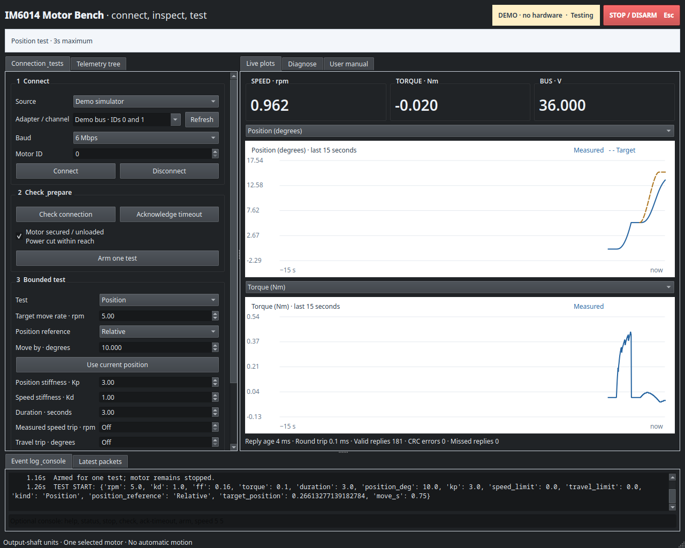
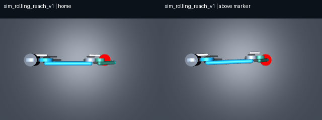

# IM6014 robotics workbench

A Linux motor bench and a simulation-first path to controlling one custom arm with Dream joint-action fine-tuning and one overhead camera.

The motor bench is implemented. The selected simulator is a self-contained single arm with base yaw and rolling shoulder/elbow joints, viewed by one overhead camera. It passes physics, URDF-import, and image-feedback reference-reaching checks. Dream training, shared-controller integration, and physical trials have separate pending gates.

## Start the motor bench

From the repository root:

```bash
python3 -m venv .venv
source .venv/bin/activate
python -m pip install -r requirements.txt
./start_dashboard.sh --demo
```

Omit `--demo` to open the hardware dashboard. Startup remains disconnected and disarmed. Connecting, scanning, and commanding a real motor require deliberate operator action. The [bench manual](docs/bench/user-manual.md) explains setup, units, limits, faults, and stopping.



## Work on the arm and Dream integration

- [Roadmap](docs/roadmap.md) shows active gates and evidence. Its source is [one milestone ledger](docs/milestones.tsv).
- [Dream integration](docs/dream-integration.md) defines the observation, action, and training contract.
- [Rolling-joint design](docs/rolling-joints.md) explains mechanics and separate model identities.
- [Run the selected reaching simulator](examples/rolling_reach_arm/README.md) without hardware or private CAD.
- [Run the rolling sample](examples/rolling_contact_arm/README.md) to reproduce simulator, SDK, and dataset checks.
- [Development guide](CONTRIBUTING.md) gives the layout and offline checks.

The [GitHub work queue](https://github.com/sidrk-dev/im6014Development/issues) groups immediate execution work under [two phase milestones](https://github.com/sidrk-dev/im6014Development/milestones). Gate acceptance stays in the repository ledger.



## Repository layout

| Path | Ownership |
| --- | --- |
| `im6014_control/` | Portable C12 joint state machine, records, mapping, reference planning and codec; no transport. |
| `im6014_bench/` | Protocol/bench CLI, serial-session owner, and Qt dashboard. |
| `tests/control/` | 108 preserved committed-controller regressions. |
| `tests/bench/` | Packet, fake transport, lifecycle, and UI checks. |
| `examples/rolling_reach_arm/` | Selected three-coordinate rolling-arm scene and RGB reference baseline. |
| `examples/rolling_contact_arm/` | Illustrative MuJoCo/URDF model and Dream adapter. |
| `docs/` | Current architecture, roadmap, integration, and bench instructions. |
| `reports/` | Selected reproducibility reports and dated research. |
| `scripts/` | Offline check entry points and roadmap/link validation. |
| `.github/` | CI and contribution templates. |

Generated runs, screenshots, videos, and datasets belong in ignored `results/` directories. Vendor archives, bench records, environments, and independent development checkouts remain outside the published source tree.

The [legacy planning archive](docs/archive/README.md) preserves the former 195-item plan and its mapping to current gates. It is historical reference, not a second execution queue.
