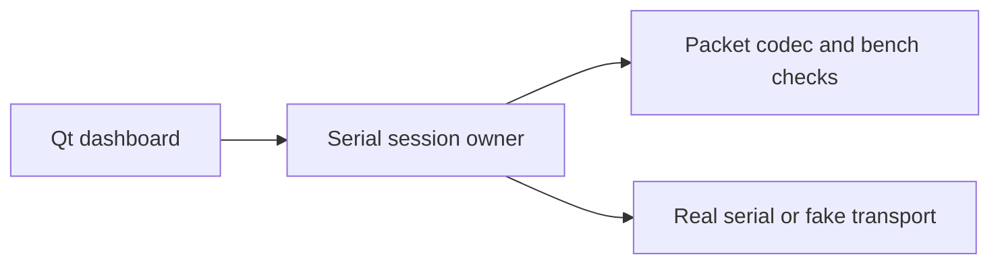

# Code and evidence ownership

This repository contains the motor bench and a self-contained rolling-arm experiment. The [roadmap](roadmap.md) tracks the integration needed for the selected single-arm learning workflow.

## Bench application

`im6014_bench/dashboard.py` presents state and controls. `session.py` owns communication and lifecycle transitions. `motor.py` contains packet helpers and the bounded single-motor CLI. `start_dashboard.sh` is the stable desktop entry point and works from any current directory.

The package is checkout-runnable. There is no library distribution or extra packaging layer to maintain. Bench and simulation/SDK dependencies remain separate.

## Simulation and learned control

`examples/rolling_contact_arm` exposes two logical bends for ideal circular rolling. It is not final CAD or a commissioned drive controller. Its mocked SDK response checks handling, not task intelligence. See [Dream integration](dream-integration.md) and [rolling joints](rolling-joints.md).

The future runtime sends images, measured independent state, and task text to a hosted joint-action fine-tune. Targets pass through shared-controller timing, ownership, faults, position, velocity, acceleration, lead, and effort checks. Physics and local control continue during network delay.

`im6014_control` contains the reviewed committed C12 pure controller closure from the independent public arm-control repository. `core.py` owns the ordered joint lifecycle, ownership, target and fault state machine; `records.py`, `mapping.py`, `reference.py`, and `codec.py` own records and pure transformations. [Provenance and imports](../im6014_control/README.md) and [port verification](../reports/controller-core/README.md) describe its scope. It imports no serial transport and does not replace the bench session owner.

Independent local checkouts and their unfinished C13 edits remain untouched. The portable C12 source and scalar effort checks form a software foundation for SA04. The [effort report](../reports/controller-effort/README.md) scopes the added protection. The [native drive representation](../reports/native-drive/README.md) binds fixed MuJoCo gains to the shared planner without changing physical codec limits. Its example-owned factory validates loaded drive metadata. The [simulator station](../reports/rolling-station/README.md) now owns actual stepping, immutable capture/reply provenance, original deadlines, full model identity, and explicit actuation. Parent checks establish simulated scheduling under injected delays. Actual hosted-worker timing, dashboard-failure integration, and remaining C14-C16 acceptance are still required. The reference example governor does not accept those gates.

## Selected simulation

`examples/rolling_reach_arm` selects `sim_rolling_reach_v1`: three logical coordinates (base yaw and two rolling bends), five internal hinges, a payload, table, red marker, and overhead RGB camera. `scene.py` owns the assumed model and generated manifest; `reach.py` owns the hand-coded image-feedback baseline; `verify.py` checks loaded mechanics, import, and reaching. `verify_dream.py` binds the selected profile and validates rendered/measured observations with the real pinned SDK through mocked transport. Shared fixture mechanics live in `scripts/dream_client_fixture.py`; older profile checks retain their own evidence. Its governor is a reference-test component and does not accept SA04 shared-controller obligations.

This independently designed simulation needs no private CAD, measured hardware masses, or motor port. It models ideal no-slip circular rolling and assumed tendon actuation. It is not a calibrated digital twin.

## Model assets

The public example is self-contained. The CAD-derived prototype URDF currently exists only in a local development checkout and is not shipped here. The [prototype contract](single-arm-contract.json) and its import evidence remain scoped to that earlier CAD profile. Current simulation uses the [reaching scenario](../examples/rolling_reach_arm/README.md); its generated manifest records assumed geometry, masses, camera, timing, and task. Final hardware-matched rolling geometry remains a separate RC01-RC04 revision.

## Results and history

Bench outputs live in `results/bench`. Example outputs live in each example's ignored `results/` directory. Both are ignored. Selected JSON reports and images are versioned in `reports/` and `docs/assets/`.

`reports/research` and `docs/archive` retain dated investigations and superseded plans. Historical records preserve original paths and revision-limited claims; they are not current instructions. Vendor ZIPs, raw telemetry, and machine-specific launchers are retained in ignored `.local/artifacts`. Independent checkouts and environments stay in place.
