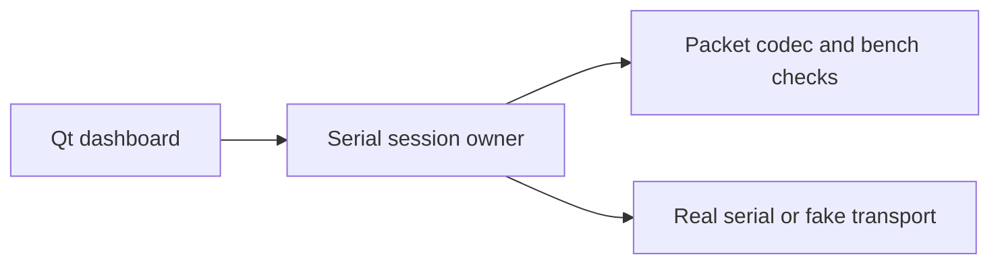

# Code and evidence ownership

This repository contains the motor bench and a self-contained rolling-arm experiment. The [roadmap](roadmap.md) tracks the integration needed for the selected single-arm learning workflow.

## Bench application

`im6014_bench/dashboard.py` presents state and controls. `session.py` owns communication and lifecycle transitions. `motor.py` contains packet helpers and the bounded single-motor CLI. `start_dashboard.sh` is the stable desktop entry point and works from any current directory.

The package is checkout-runnable. There is no library distribution or extra packaging layer to maintain. Bench and simulation/SDK dependencies remain separate.

## Simulation and learned control

`examples/rolling_contact_arm` exposes two logical bends for ideal circular rolling. It is not final CAD or a commissioned drive controller. Its mocked SDK response checks handling, not task intelligence. See [Dream integration](dream-integration.md) and [rolling joints](rolling-joints.md).

The future runtime sends images, measured independent state, and task text to a hosted joint-action fine-tune. Targets pass through shared-controller timing, ownership, faults, position, velocity, acceleration, lead, and effort checks. Physics and local control continue during network delay.

Local `.worktrees/controller-*` folders belong to independent checkouts associated with a separate workbench repository. This cleanup preserves them unchanged. Their accepted code and ledger must be reconciled at SA04; they are not in a fresh public clone. Unaccepted C13-C16 requirements remain explicit in the roadmap checklist.

## Selected simulation

`examples/rolling_reach_arm` selects `sim_rolling_reach_v1`: three logical coordinates (base yaw and two rolling bends), five internal hinges, a payload, table, red marker, and overhead RGB camera. `scene.py` owns the assumed model and generated manifest; `reach.py` owns the hand-coded image-feedback baseline; `verify.py` checks loaded mechanics, import, and reaching. Its governor is a reference-test component and does not accept SA04 shared-controller obligations.

This independently designed simulation needs no private CAD, measured hardware masses, or motor port. It models ideal no-slip circular rolling and assumed tendon actuation. It is not a calibrated digital twin.

## Model assets

The public example is self-contained. The CAD-derived prototype URDF currently exists only in a local development checkout and is not shipped here. The [prototype contract](single-arm-contract.json) and its import evidence remain scoped to that earlier CAD profile. Current simulation uses the [reaching scenario](../examples/rolling_reach_arm/README.md); its generated manifest records assumed geometry, masses, camera, timing, and task. Final hardware-matched rolling geometry remains a separate RC01-RC04 revision.

## Results and history

Bench outputs live in `results/bench`. Example outputs live in each example's ignored `results/` directory. Both are ignored. Selected JSON reports and images are versioned in `reports/` and `docs/assets/`.

`reports/research` and `docs/archive` retain dated investigations and superseded plans. Historical records preserve original paths and revision-limited claims; they are not current instructions. Vendor ZIPs, raw telemetry, and machine-specific launchers are retained in ignored `.local/artifacts`. Independent checkouts and environments stay in place.
