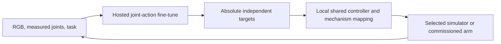

# Single-arm Dream joint-action integration

Use one arm, one fixed scene camera with role `overhead`, and measured independent joint positions. Collect task demonstrations, validate them, and fine-tune a joint-action model before deploying learned targets. The [roadmap](roadmap.md) owns acceptance.

## Coordinate and camera contract

Freeze build/model identity, actual independent count/order, signs/zeros, radians, tool, limits, absolute-target meaning, and timing. Passive rolling hinges stay internal. Gripper channels exist only for a build with a gripper.

The [sample embodiment](../examples/rolling_contact_arm/dream_embodiment.json) declares a two-value `arm` part with `side: single` in state/action, one overhead video feature, and absolute actions. `[0, 2]` is a vector span, not a limit. The prototype needs its own three-coordinate profile; final coordinates follow RC01.

Dream client 1.0.3 maps `state.arm` to its internal right-arm slot and restores `reply["per_key"]["action.arm"]`. Omit `ik` and `robot="other_embodiment"` for this route. Dream's stock IK importer rejects moving mimic joints. The local simulator/controller owns rolling constraints.

Freeze camera mounting, calibration, crop, orientation, capture times, history, and freshness. Verify actual overhead target/tool visibility. The sample camera looks normal to a planar load-test scene; its API role does not establish physical placement. Evaluator coordinates, contacts, and success labels stay outside policy inputs.

## Demonstrations and inference

Record images and measured state at the sample boundary, with the controller-issued reference for the following interval. Keep requested, accepted, and issued targets distinct. Freeze dataset/capture/control/action rates, history, timebase, and age limits. Inspect replay and processed timing; hosted processing may retime rows from frame index/FPS.

Start with fixed-tool reaching, then pushing. Budget 20 successful training demonstrations and five validation episodes for the first experiment. Freeze ten separate evaluation scenes, including four target shifts, outside training uploads. Use a provisional 20 mm tool-distance threshold and one-second settling interval. Freeze timeout and all-attempt reporting before training. Eight successes, including three shifted cases, is an exploratory screen rather than a reliability claim.

Use an appropriate single-arm joint-action fine-tuned checkpoint. A stock YAM joint head is not this arm's controller. Reject invalid shape, nonfinite values, wrong units/build, excessive targets, expired/reordered replies, and stale ownership before dispatch. Local control continues during inference; takeover/fault invalidates outstanding chunks.

Test key/deadman release, focus loss, gamepad unplug/reconnect, stale images, delayed/reordered replies, unavailable joints, network failure, and expired commands. Reconnect never resumes automatically. Use the build's accepted supported hold/stop behavior; torque release can drop a gravity-loaded arm.

## Service and physical gates

The [local results](../reports/rolling-contact/README.md) cover mechanics, SDK behavior with mocked transport, and dataset preflight. The 90-frame fixture is not a task-training set. Hosted processing, learned checkpoints, and policy behavior remain unverified.

Before a hosted job, verify account access, actual model identity, processing, data recording, current price, and authorized funding. Begin with one submission and retain its job ID to avoid duplicate retries. A polling timeout is not a spending cap. Do not assume priced jobs can be cancelled or simulation fine-tunes can initialize physical-data training.

RC03 precedes final-profile demonstrations; RC04 precedes final-profile upload. Prototype work has its own chain. Physical data/trials require an accepted task-capable actual build, calibration, loaded-joint/tool/camera checks, and explicit live scope. Absent future wrists/scoop are not first-task prerequisites.

Before SA14, freeze a separate physical held-out set, measured tolerance, timeout, and stopping criteria. Report all attempts and interventions independently of simulation results.

Meet that frozen measured acceptance rule before accepting SA14 or increasing physical difficulty/duration at SA15.
