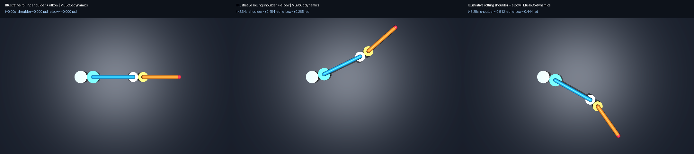

# Run the illustrative rolling-contact arm

This self-contained sample has rolling shoulder and elbow joints, two independent logical bends, a MuJoCo model, a mimic URDF, and a Dream joint-action adapter. Dimensions and inertias are illustrative; the prototype and final arm remain separate models.



## Run the checks

From the repository root, use a separate Python environment. The tested runtime is Python 3.14.6 on Linux.

```bash
python3 -m venv .venv-rolling-sample
.venv-rolling-sample/bin/python -m pip install -r examples/rolling_contact_arm/requirements.txt
.venv-rolling-sample/bin/python -m pip check
MUJOCO_GL=egl .venv-rolling-sample/bin/python examples/rolling_contact_arm/verify.py --render
MUJOCO_GL=egl .venv-rolling-sample/bin/python examples/rolling_contact_arm/verify_dream.py
MUJOCO_GL=egl .venv-rolling-sample/bin/python examples/rolling_contact_arm/record_dataset.py
```

EGL works on the development workstation. CI uses OSMesa. Without `--render`, geometry/dynamics checks require no graphics context. The SDK and dataset checks render actual images and need a working backend. No API key, hosted call, or physical motor is involved.

All generated imports, videos, datasets, screenshots, and JSON go under ignored `examples/rolling_contact_arm/results/`. Selected verified reports are published separately in [reports/rolling-contact](../../reports/rolling-contact/README.md).

## Files and coordinate contract

`model.py` generates the ready-to-load `arm.xml`, `arm.urdf`, and `manifest.json`. `verify.py` checks geometry, Jacobians, material contact velocity, loaded dynamics, import behavior, and deliberately broken constraints. `dream_bridge.py` validates complete action chunks before actuation. `verify_dream.py` exercises the actual SDK while mocking credentials resolution and transport. `record_dataset.py` records a calibration sweep and runs Dream's actual local upload preflight.

Dream sees `[shoulder_bend, elbow_bend]` in radians, with absolute target rows. Each equal-radius mechanism has `bend=a+b` and `b=a`. Passive hinges do not become extra policy channels. The native model actuates a fixed tendon of length `a+b`, so targets are complete bends, not halved values. This is not an actual motor/transmission model.

The single scene camera looks normal to the XY mechanism plane; gravity is -Y for the load test. Its API role `overhead` does not calibrate a physical overhead camera.

The 90-frame recording is a synthetic format fixture, not task demonstrations. An appropriate joint-action fine-tune and held-out behavior checks are still required. Dream's stock IK importer rejects the mimic joints; use the [local mechanism/joint-action route](../../docs/dream-integration.md). See [rolling-joint design](../../docs/rolling-joints.md) for modeling limits.

To inspect the mechanism manually:

```bash
.venv-rolling-sample/bin/python -m mujoco.viewer --mjcf=examples/rolling_contact_arm/arm.xml
```
